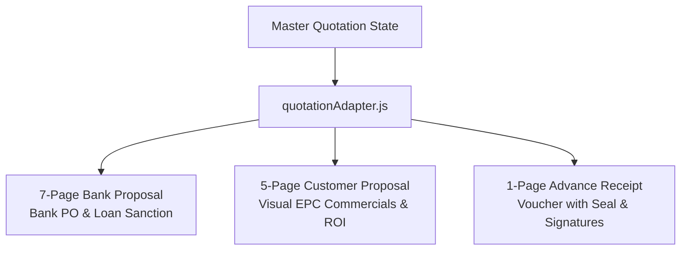
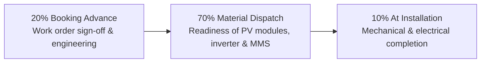

# ☀️ M/s. SRIMAAN SOLAR SOLUTIONS
## Master Solar Quotation, Bank PO & Advance Receipt Management System

> **Enterprise Turnkey Solar EPC Platform** engineered for residential, commercial, and institutional grid-connected rooftop photovoltaic projects. Features pixel-accurate dual document generation (7-Page Official Bank Loan Proposal + 5-Page High-Impact Customer Visual Proposal), 1-Page Official Advance Payment Receipt Vouchers, Master Admin Panel, and statutory Indian Solar EPC 70:30 GST calculation compliance.

---

## 📑 Table of Contents
1. [Executive Summary & Company Credentials](#-executive-summary--company-credentials)
2. [Tri-Document Generation Architecture](#-tri-document-generation-architecture)
   - [Document 1: 7-Page Official Bank Proposal](#1-7-page-official-bank-proposal)
   - [Document 2: 5-Page Customer Visual Proposal](#2-5-page-customer-visual-proposal)
   - [Document 3: 1-Page Advance Payment Receipt](#3-1-page-advance-payment-receipt)
3. [Statutory Solar EPC GST (70:30 Bifurcation) Engine](#-statutory-solar-epc-gst-7030-bifurcation-engine)
4. [Commercial Terms & Milestone Schedule (20 : 70 : 10)](#-commercial-terms--milestone-schedule-20--70--10)
5. [Dual Commercial Pricing Architecture](#-dual-commercial-pricing-architecture)
6. [Master Admin Panel & Quotation Settings](#-master-admin-panel--quotation-settings)
7. [Technical Hardware Catalog & ALMM Standards](#-technical-hardware-catalog--almm-standards)
8. [Automated Verification & Audit Test Suite (161 Tests)](#-automated-verification--audit-test-suite-161-tests)
9. [Project Directory & File Structure](#-project-directory--file-structure)
10. [Quick Start & Standalone Deployment](#-quick-start--standalone-deployment)

---

## 🏢 Executive Summary & Company Credentials

All quotation documents, invoices, vouchers, and contracts strictly adhere to the official business profile of **M/s. SRIMAAN SOLAR SOLUTIONS**:

| Detail | Official Company Information |
| :--- | :--- |
| **Legal Entity Name** | **M/s. SRIMAAN SOLAR SOLUTIONS** |
| **Authorized Signatory** | **T. Ravindra Chary** (Managing Director / Authorized Signatory) |
| **Registered Head Office** | `6-210 SRIRAMNAGAR BEHIND AUTONAGAR WARANGAL X ROAD, Edulapuram Muncipalty, Khammam district, Telangana State 507003` |
| **Branch / Service Network** | **Hyderabad HQ \| Khammam \| Suryapet \| Warangal** |
| **GSTIN Number** | `36ADPPT2441N1ZW` (Telangana State Code: 36) |
| **Permanent Account No (PAN)** | `ADPPT2441N` |
| **DISCOM Vendor Reg No** | `TSRE250511` (TSNPDCL / TSSPDCL Empanelled EPC) |
| **Official Contact Mobile** | `+91 9347416140`, `+91 9912416140` |
| **Official Email Addresses** | `srimaansolarsolutions@gmail.com`, `Ravindrachary1972@gmail.com` |
| **Primary Bank Account (HDFC)** | **HDFC BANK**, A/C: `50200095253784`, IFSC: `HDFC0001631`, Khammam |
| **Secondary Bank Account (SBI)** | **STATE BANK OF INDIA**, A/C: `44813579950`, IFSC: `SBIN0065049`, Khammam |

---

## 🖨️ Tri-Document Generation Architecture

The platform operates on a unified proposal state model that dynamically renders three distinct document formats:



---

### 1. 7-Page Official Bank Proposal
Meticulously engineered to replicate official bank loan sanction dossiers and purchase order standards:

- **Page 1: Cover & Techno Offer**: Company banner, Solar hero header, bold italic proposal title, Cyan Reference Number (linked 1:1 to Customer UNC / Electricity Consumer Number), Submission Date, Red-underlined Customer Particulars, and Blue-underlined Official EPC Vendor Credentials box.
- **Page 2: On-Grid System Architecture**: Technical explanation of grid-connected solar PV systems, dual MPPT string inverter mechanics, bidirectional net-metering, and high-resolution system schematic diagram.
- **Page 3: Techno-Commercial Solar Benefits**: Dynamic capacity introduction with 9 comprehensive benefits of rooftop solar energy adoption.
- **Page 4: Technical Specifications & Mounting**: Technical component schedule, generation outputs (Daily, Monthly, Annual kWh), shadow-free area requirements, and side-by-side **BASIC** and **ELEVATED (HEIGHT)** mounting structure photographs.
- **Page 5: Cost Estimations & Bill of Materials (BOM)**: Formal "RESPECTED SIR / MADAM" salutation, 12-item detailed BOQ table with `#B7D7A8` light green header, Gross Project Cost row, PM Surya Ghar central subsidy row, and Net Project Cost row.
- **Page 6: Subsidy, Payback & Bank Details**:
  - **PRICE OFFER Table**: Statutory 70:30 GST bifurcation displaying Goods (5%) Base, CGST (2.5%), SGST (2.5%), Services (18%) Base, CGST (9%), SGST (9%), and Total Project Amount.
  - **Payback Analysis Table**: System capacity, daily production, annual generation, unit savings, and capital payback period in years.
  - **Statutory PM Surya Ghar National Portal Guidance**: DBT subsidy claim steps and documentation requirements.
  - **Dual Bank Account Details**: Green box containing **HDFC Bank** (Primary) and **State Bank of India** (Secondary) NEFT/RTGS/IMPS account details.
- **Page 7: Commercial Terms & Conditions**: 13-clause bordered table covering 30-day offer validity, **Payment Terms (20% Booking, 70% Material Dispatch, 10% Completion)**, Delivery timelines, Scope boundaries, and **Warranties (25 Years SPV Output Power / 7 Years Inverter)**.

---

### 2. 5-Page Customer Visual Proposal
A high-converting, modern presentation deck formatted for residential and commercial customers:

- **Page 1: Executive Cover & ROI Snapshot**: Premium navy header, Tier-1 solar modules banner, customer metadata card, system capacity badge, and high-impact 25-year financial metrics.
- **Page 2: Hardware Specifications & Technical BOQ**: Detailed technical specifications for TOPCon / Mono PERC modules, smart on-grid inverter, hot-dip galvanized elevated structure, and 12-line Bill of Materials.
- **Page 3: Commercial Investment & Statutory Price Offer**:
  - **Commercial Investment Schedule**: Base turnkey cost, taxable sub-total, statutory GST, total gross project cost, central DBT subsidy, and net customer investment.
  - **ROI & Payback Metrics**: Capital payback period in years, annual power savings, and 25-year net financial profit.
  - **Comparative Yield Matrix**: Rooftop solar (28%–32% IRR) vs Bank FD (7%) vs Equity MF (13%) vs Real Estate (3%).
  - **PRICE OFFER Table**: Statutory 70:30 GST bifurcation calculated on 100% full project cost.
- **Page 4: Payment Terms, Warranties & Acceptance**:
  - **20 : 70 : 10 Milestones**: Booking advance, Material dispatch, and System completion calculated on full project cost.
  - **Delivery & Commissioning Terms**: Delivery upon 90% payment receipt; 30-day post-installation net-metering commissioning.
  - **Warranties & Technical Annexure**: 25-Year 84.8% linear performance warranty, 12-year workmanship warranty, and 10-year inverter warranty.
  - **Authorized Signatory Rubber Stamp**: Circular corporate seal and signature block for Er. R. Jayaram Reddy / T. Ravindra Chary.
- **Page 5: Corporate Profile, Scope Matrix & Connect**:
  - **Company Profile**: Background, empanelment status, and regional branch network across Telangana.
  - **Scope of Work Responsibility Matrix**: 6-item toggle matrix clearly distinguishing EPC Scope vs Client Scope.
  - **Digital Connect**: QR codes for WhatsApp instant inquiry and official website portal.

---

### 3. 1-Page Advance Payment Receipt
Matches official Srimaan receipt voucher format (`RECEIPT_3KW.xlsx`) with authentic company letterhead and official round rubber seal:

- **Header**: Official blue banner (`ADVANCE PAYMENT`), company contact info, GSTIN, PAN, and Vendor Registration number.
- **Customer Metadata**: Name, Service Address, District, PIN Code, Mobile No, Email, and Electricity Consumer Number (UNC).
- **Financial Breakup Table**:
  - `Total Project Cost`: Full gross project cost (inclusive of statutory GST).
  - `Advance Payment`: Advance token amount received (20% or 10%).
  - `Balance Amount to be paid`: Remaining balance payable on or before material dispatch.
  - `Amount Received in Rupees`: Advance amount formatted in standard INR.
  - `Amount in Words`: Fully automated Indian English currency words converter (e.g., `TWENTY TWO THOUSAND ONLY`).
- **Payment Verification**: Payment Mode checkboxes (Cash, Cheque, RTGS/NEFT/UPI), transaction reference, and purpose note.
- **Official Signatory**: Receiver Name (`T.RAVINDRA CHARY`), Mobile (`9347416140`), date, signature line, and official circular rubber seal.
- **Interactive Inline Editing**: Allows users to type directly on the voucher canvas or configure values via form modal controls.

---

## ⚖️ Statutory Solar EPC GST (70:30 Bifurcation) Engine

Under Indian GST Law and Ministry of New and Renewable Energy (MNRE) notifications for composite turnkey Solar EPC contracts, project billing must be split into two deemed components:

$$\text{Total Project Cost } (P) = \text{Goods Component } (70\%) + \text{Services Component } (30\%)$$

1. **70% Goods (Solar PV Modules & Inverters)**:
   - Taxable at **5% GST** (2.5% CGST + 2.5% SGST)
   - $\text{Goods Base Value} = \text{Round}\left(\frac{P \times 0.70}{1.05}\right)$
   - $\text{Goods CGST} = \text{Round}(\text{Goods Base} \times 0.025)$
   - $\text{Goods SGST} = \text{Round}(\text{Goods Base} \times 0.025)$

2. **30% Services (Civil Works, MMS, Cabling, BOS, I&C)**:
   - Taxable at **18% GST** (9% CGST + 9% SGST)
   - $\text{Services Base Value} = \text{Round}\left(\frac{P \times 0.30}{1.18}\right)$
   - $\text{Services CGST} = \text{Round}(\text{Services Base} \times 0.09)$
   - $\text{Services SGST} = \text{Round}(\text{Services Base} \times 0.09)$

### 🚨 Critical Statutory Rule: GST Calculation Pre-Subsidy
> [!IMPORTANT]
> **Statutory GST is ALWAYS calculated on 100% of the Total Turnkey Project Cost BEFORE deducting Government Subsidy.**  
> - **The Vendor's Tax Invoice and PO apply to the entire gross contract amount.**  
> - **Central Government CFA Subsidy (e.g., ₹78,000 under PM Surya Ghar) is a Direct Benefit Transfer (DBT) deposited directly into the consumer's bank account post net-metering.**  
> - **Example**: If Total Project Cost is ₹1,00,000 and Subsidy is ₹20,000:
>   - Taxable Base and GST are computed strictly on **₹1,00,000** (Taxable Base: ₹92,091 + Total GST: ₹7,910 = ₹1,00,000).
>   - Net Customer Out-of-Pocket is **₹80,000** (₹1,00,000 − ₹20,000).
>   - GST is **NEVER** calculated on the discounted net amount (₹80,000).

---

## 💰 Commercial Terms & Milestone Schedule (20 : 70 : 10)

All payment schedules in the platform follow the statutory standard:



| Milestone Stage | Percentage | Purpose & Trigger | Basis |
| :--- | :---: | :--- | :--- |
| **Stage 1: Booking Advance** | **20%** | Along with purchase order / work order sign-off to initiate site engineering survey and DISCOM net-meter application filing. | Calculated on **Full Project Cost** |
| **Stage 2: Material Dispatch** | **70%** | Upon factory readiness and prior to physical dispatch of Tier-1 solar modules, inverter, structure, and BOS to site. | Calculated on **Full Project Cost** |
| **Stage 3: System Completion** | **10%** | Upon completion of physical installation, electrical testing, and submission of work completion report for net-meter synchronization. | Calculated on **Full Project Cost** |

---

## 🏷️ Dual Commercial Pricing Architecture

The system isolates commercial pricing between Bank PO proposals and Customer Quotations:

1. **Bank PO Price (`pricing.bankCost`)**:
   - The official turnkey contract amount displayed on Bank Proposal **Page 5 (BOM)**, **Page 6 (GST Bifurcation)**, and the **Advance Receipt Voucher**.
   - Reflects the higher commercial valuation required for bank loan sanctioning and margin money calculation.
2. **Customer Quote Price (`pricing.customerCost`)**:
   - The agreed competitive customer price displayed on the **Customer 5-Page Visual Proposal**.
   - Used to compute actual client out-of-pocket net investment and payback economics.
3. **Automated PO Margin Differential**:
   - Displays real-time markup percentages and difference values in the editor (`bankCost − customerCost`).

---

## ⚙️ Master Admin Panel & Quotation Settings

Accessible via the **⚙️ Settings** modal in the top navigation bar. Configurations are saved persistently in `localStorage`:

- **Tab 1: Company & Statutory**: Legal entity name, taglines, CIN, GSTIN, PAN, Vendor Reg No, phone numbers, emails, registered address, and branch offices.
- **Tab 2: Banking & Accounts**: Primary bank (HDFC Bank) and Secondary bank (State Bank of India) account numbers, IFSC codes, branches, and payment notes.
- **Tab 3: Cover Page & Hero**: Document titles, subtitle hero descriptions, and branding badges.
- **Tab 4: Technical & Hardware Catalogs**:
  - Solar PV Modules: Brand names, model descriptions, rated wattages (Wp), cell technologies, and efficiency ratings.
  - Solar Grid Inverters: Inverter brands, models, phase ratings, and efficiency ratings.
  - Mounting Structures: Material specifications (Hot-Dip Galvanized Iron), zinc coating thickness (80 Microns / IS 4759), and wind speed compliance (up to 150 km/h / IS 875 Part 3).
  - Balance of System (BOS): Cable standards (Polycab 4/6 sq.mm TUV) and earthing chemical standards (3-pit copper chemical earthing).
- **Tab 5: Pricing, Subsidy & ROI**: 1kW (₹30k), 2kW (₹60k), 3kW+ (₹78k) subsidy slabs, default DISCOM tariffs (₹8.0/unit), and comparative yields.
- **Tab 6: Warranties, Scope & O&M**:
  - 4 Warranty statements (25-year performance, 12-year module workmanship, 10-year inverter, 5-year AMC).
  - Scope of Work Responsibility Matrix with individual EPC Scope / Client Scope toggles.
  - Authorized Signatory and Circular Rubber Stamp customizer.
- **Tab 7: Portfolio & Showcase**: Featured installation project titles, locations, capacities, module counts, and live photos.

---

## 🛠️ Technical Hardware Catalog & ALMM Standards

The platform supports all major Tier-1 Approved List of Models and Manufacturers (ALMM) brands:

### Solar Photovoltaic Modules
- **Waaree Energies**: Arka Series 550Wp Bi-facial Dual Glass N-Type TOPCon 16BB (22.3% Efficiency)
- **Adani Solar (Mundra)**: Shine Series 545Wp Mono PERC Half-Cut Module 10BB (21.5% Efficiency)
- **Tata Power Solar / TP Solar**: TP550 High-Efficiency Tier-1 Mono PERC Module (21.4% Efficiency)
- **Vikram Solar, Premier Energies, Goldi Solar, Rayzon Solar, Saatvik Green Energy**

### Grid-Tied Solar Inverters
- **Sungrow Power**: SG5.0RS Multi-MPPT On-Grid Smart Inverter with Wi-Fi IoT (98.4% Efficiency)
- **Growatt New Energy**: MIN / MID Series Dual MPPT Smart Inverter with ShineWiFi (98.4% Efficiency)
- **Solis Ginlong**: S6 Pro Series Solar Grid-Tied Inverter with Remote Cloud Telemetry (98.5% Efficiency)
- **Polycab Solar, Havells Enviro, Deye Solar**

---

## 🧪 Automated Verification & Audit Test Suite (161 Tests)

The repository features comprehensive automated audit suites executed via Node.js before every release:

```bash
node scripts/run-audits.js && node scripts/audit-e2e.js
```

### Audit Coverage Summary:
- **Suite 1: Calculation Engine**: Subsidy capping (1kW ₹30k, 2kW ₹60k, $\ge 3$kW ₹78k), Indian rupee number-to-words conversion, solar daily/monthly/annual generation metrics, and capital payback periods.
- **Suite 2: Statutory GST EPC Module**: Goods Base, CGST (2.5%), SGST (2.5%), Services Base, CGST (9%), SGST (9%), and 100% total cost reconstruction across benchmark test amounts (₹2,25,000, ₹3,75,000, ₹4,10,000, and ₹4,75,000).
- **Suite 3: Currency & Formatting**: Indian comma grouping (`formatINR`), two-decimal formatting (`formatINRDecimal`), and localized date formatting.
- **Suite 4: Assets & Logos**: Embedded Base64 assets, official Srimaan logos, Waaree/Tata/Adani brand logos, PM Surya Ghar emblems, MNRE emblems, and high-res hardware photography.
- **Suite 5 & 6: React Components**: Structural integrity of Page1 through Page7, CustomerPage1 through CustomerPage5, AdvanceReceiptView, SettingsModal, and QuotationFormView.
- **Suite 7: Data Adapter**: Seamless conversion between unified Bank proposal state and 5-page Customer proposal format.
- **Suite 8 & 9: Import Integrity & Data Defaults**: Verifies 100% of JSX tags, Lucide icons, and default parameters are cleanly resolved without runtime exceptions.

---

## 📂 Project Directory & File Structure

```
ss-bank-quota/
├── index.html                        # Application entry HTML
├── package.json                      # Build scripts and project dependencies
├── vite.config.js                    # Vite bundler configuration
├── tailwind.config.js                # Custom Tailwind design system & print styles
├── scripts/
│   ├── run-audits.js                 # 161-assertion core system audit harness
│   ├── audit-e2e.js                  # End-to-end integration test harness
│   └── bundle-standalone.js          # Inlines JS, CSS & assets into standalone HTML
├── public/
│   ├── logo.png                      # Application favicon & header logo
│   └── assets/                       # High-resolution logos, emblems & photos
├── src/
│   ├── main.jsx                      # React application mounting root
│   ├── App.jsx                       # Master state management, routing & persistence
│   ├── index.css                     # Global Tailwind utilities & A4 print engine
│   ├── assets/
│   │   └── assetsData.js             # Base64 embedded high-res assets & diagrams
│   ├── data/
│   │   └── defaultData.js            # Initial quotation state, capacity presets & BOM
│   ├── utils/
│   │   ├── calculations.js           # Solar metrics, GST bifurcation & number-to-words
│   │   ├── formatters.js             # Currency, numbers & Indian date formatters
│   │   ├── brandLogos.js             # Hardware manufacturer SVG logos & badges
│   │   └── quotationAdapter.js       # Bi-directional state adapter (Bank <-> Customer)
│   └── components/
│       ├── Navbar.jsx                # Top app navigation, view switcher & settings button
│       ├── DashboardView.jsx         # Executive dashboard with quote management cards
│       ├── QuotationFormView.jsx     # Master 5-step interactive proposal editor
│       ├── ProposalPreviewModal.jsx  # Live A4 print preview, WhatsApp share & zoom
│       ├── AdvanceReceiptView.jsx    # Official 1-page advance payment receipt voucher
│       ├── SettingsModal.jsx         # 7-tab master company & hardware settings panel
│       ├── PageHeader.jsx            # Standardized 7-page proposal header
│       ├── PageFooter.jsx            # Standardized 7-page proposal footer
│       ├── Page1.jsx                 # Bank P1: Cover & Legal Offer Submission
│       ├── Page2.jsx                 # Bank P2: On-Grid System & Flow Schematic
│       ├── Page3.jsx                 # Bank P3: Techno-Commercial Solar Benefits
│       ├── Page4.jsx                 # Bank P4: Specifications & Mounting Photos
│       ├── Page5.jsx                 # Bank P5: 12-Item BOM Table & Cost Estimation
│       ├── Page6.jsx                 # Bank P6: GST Bifurcation, Payback & Dual Banks
│       ├── Page7.jsx                 # Bank P7: 20:70:10 Payment Terms & Warranties
│       └── customerPages/
│           ├── CustomerPage1Cover.jsx         # Customer P1: Executive Cover & ROI
│           ├── CustomerPage2SystemSpec.jsx    # Customer P2: Hardware Specs & BOM
│           ├── CustomerPage3Financials.jsx    # Customer P3: Commercials & Cashflow
│           ├── CustomerPage4Portfolio.jsx     # Customer P4: Payment Terms & Stamp
│           ├── CustomerPage5CompanyProfile.jsx# Customer P5: Profile, Scope & QR
│           ├── CustomerPageHeader.jsx         # Customer proposal header banner
│           └── CustomerPageFooter.jsx         # Customer proposal footer banner
```

---

## 🚀 Quick Start & Standalone Deployment

### Option 1: Development Server (Vite)
```bash
# 1. Install dependencies
npm install

# 2. Run system audits
node scripts/run-audits.js && node scripts/audit-e2e.js

# 3. Start local development server
npm run dev
```
Open [http://localhost:5173/](http://localhost:5173/) in your web browser.

---

### Option 2: Production Build
```bash
npm run build
```
Generates production assets in `dist/` and compiles the single-file standalone distribution:
📁 `dist/Srimaan_Solar_Quotation_Generator.html`

---

### Option 3: Double-Click Standalone File (100% Offline)
The root directory includes `Srimaan_Solar_Quotation_Generator.html`. Double-click to run in **Chrome**, **Safari**, **Edge**, or **Brave** with:
- Zero installation, Node.js, or server dependencies.
- 100% offline functionality.
- Full access to all document generators, PDF printing, and `localStorage` persistence.

---

## 📜 Legal & Compliance Disclaimer
This software and generated documents strictly comply with:
- **Ministry of New and Renewable Energy (MNRE)** Rooftop Solar Scheme Guidelines.
- **PM Surya Ghar: Muft Bijli Yojana** Central Financial Assistance (CFA) rules.
- **Central Goods and Services Tax (CGST) & Integrated Goods and Services Tax (IGST)** composite turnkey EPC 70:30 tax schedules.
- **Bureau of Indian Standards (BIS)** & **Approved List of Models and Manufacturers (ALMM)** technical mandates.

*Maintained by M/s. SRIMAAN SOLAR SOLUTIONS Engineering Division.*
